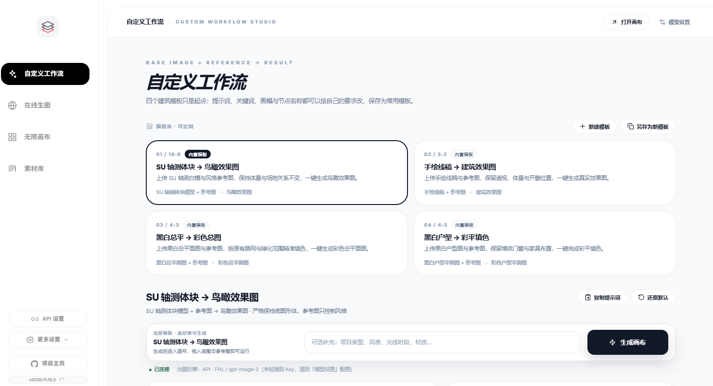

<div align="center">

<p>
  <a href="README.md">简体中文</a> ·
  <b>English</b> ·
  <a href="README.fr.md">Français</a> ·
  <a href="README.es.md">Español</a> ·
  <a href="README.ru.md">Русский</a> ·
  <a href="README.ko.md">한국어</a> ·
  <a href="README.ja.md">日本語</a>
</p>

# Infinite Canvas

**Ideas, generation, and archive — all on one canvas.**

A local-first AI creation workbench: custom workflows, online studio, infinite canvas, and asset library — four modules, one flow.<br />
No installation · Works offline · Data stays on your machine

<br />

<a href="https://iorlchoate.github.io/infinite-canvas-site/"></a>&nbsp;&nbsp;
<a href="https://github.com/Iorlchoate/Infinite-Canvas-UDG/releases/latest"></a>&nbsp;&nbsp;
<a href="#quick-start"></a>

</div>


## Quick start

1. Open [Releases](https://github.com/Iorlchoate/Infinite-Canvas-UDG/releases/latest) and download the latest `Infinite-Canvas-UDG-<version>-win.zip`
2. Unzip anywhere and double-click **`start.bat`** — your browser opens automatically (`127.0.0.1:3000`; the port moves on if busy)
3. Open **API Settings**, paste an API key, save, and start creating

> The portable package ships with Python and all offline dependencies: **no Python install, no environment setup, works offline**.
> Keep the `python/` and `packages/` folders after unzipping.

## Phone & tablet access

No app needed on the same Wi-Fi. Open the LAN address printed in the console after `start.bat`:

```text
Same Wi-Fi (phone/tablet): http://192.168.x.x:3000/
```

| Device | Browser | Recommended steps |
| --- | --- | --- |
| Android phone | Chrome / Edge | Open the address → menu "Add to Home screen" → full screen |
| Android tablet | Chrome / Edge | Open in landscape; drag nodes with one finger, pinch to zoom |
| iPhone | Safari | Open the address → Share → "Add to Home Screen" |
| iPad | Safari | Open in landscape; Share → "Add to Home Screen" |

**Touch:** one finger to drag nodes / pan the canvas, two fingers to pinch-zoom, double-tap to edit. Canvas pages feel best in landscape.

**If it does not open:** check that both devices are on the same Wi-Fi (not a guest network or cellular), use the `192.168.x.x` address from the console instead of `127.0.0.1`, allow Python through Windows Firewall, and disable VPN / router AP isolation.

> Data, assets, and API keys stay on the PC. Once the PC is off or the app is closed, phones and tablets cannot reach it. Remote access requires a tunnel or port mapping, at your own risk. Native APK / IPA builds are not available yet.

## Why local

| No account | No upload | No setup |
| --- | --- | --- |
| No sign-up, no cloud workspace | Assets, history, and API keys stay on your machine | Unzip, double-click, create |

The app only talks to the API endpoint you configure, and only when you explicitly call a cloud model.

## Four modules, one flow

| Module | In one line |
| --- | --- |
| **Custom workflows** | Four architecture templates with editable titles, aspect ratios, nodes, and prompts; keyword replacement, duplicate, and restore |
| **Online studio** | 1–9 reference images, each labeled with an IMAGE number, so prompts can refer to them directly |
| **Infinite canvas** | Free node placement and connections; text-to-image, image-to-image, inpaint, outpaint, and multi-view grids |
| **Asset library** | Groups, batch cleanup, smart categories; Chrome capture and Photoshop connector plugins |

## Screenshots

| Custom workflows | Online studio | Asset library |
| --- | --- | --- |
|  |  |  |

## Recent updates

- **Canvas alignment guides**: 7 px screen-space snapping while dragging / resizing, blue dashed guides, `Ctrl / ⌘` to suspend
- **Group containers**: 52 px header, auto-fit, aspect-ratio grid tidy, double-click rename, floating toolbar (download / long-image merge / ungroup)
- **Large-canvas viewport culling**: at 60+ nodes only nearby cards are mounted; a 300-node canvas mounts 3 cards on first paint, then mounts incrementally while panning

## Who it is for

- Architects and designers who want **reference → generation → selection → archive** on one screen
- People who use image APIs but do not want their assets and keys in a cloud workspace
- Teams that need a local asset library with Photoshop / Chrome connectors

## Docs

| What | Where |
| --- | --- |
| Project website | <https://iorlchoate.github.io/infinite-canvas-site/> |
| Download & install | [Releases](https://github.com/Iorlchoate/Infinite-Canvas-UDG/releases/latest) |
| Update notes | [update-notes.json](https://github.com/Iorlchoate/Infinite-Canvas-UDG/blob/main/update-notes.json) |
| Issues | [GitHub Issues](https://github.com/Iorlchoate/Infinite-Canvas-UDG/issues) |
| Upstream | [hero8152/Infinite-Canvas](https://github.com/hero8152/Infinite-Canvas) |

<details>
<summary><b>macOS / Linux and running from source</b></summary>

<br />

**macOS / Linux**

```bash
pip3 install -r requirements.txt
python3 main.py
```

Or run `mac-启动服务.sh`; on macOS, run `mac-修复权限.command` first if permission prompts appear.

**From source (Windows)**

```bash
git clone https://github.com/Iorlchoate/Infinite-Canvas-UDG.git
cd Infinite-Canvas-UDG
start.bat
```

</details>

<details>
<summary><b>Repository layout and releases (maintainers)</b></summary>

<br />

```text
main.py                 # FastAPI backend
static/                 # Front-end pages (canvas / assets / settings)
static/js/              # Front-end scripts
data/                   # Runtime data (canvases, assets, config)
tools/                  # Chrome / Photoshop plugins, port picker, release scripts
packages/               # Offline dependency wheels
python/                 # Portable Windows Python runtime
start.bat               # Windows entry point (dependency check + port fallback)
```

Never publish a working directory that has been run — it contains `API/.env`, `history.json`, `assets/`, and `data/`. Use the packaging scripts:

```bash
python tools/make_release_zip.py
# dist/Infinite-Canvas-UDG-<version>-win.zip

python tools/make_release_dir.py
# dist/Infinite-Canvas-UDG-<version>-publish/
```

</details>

## FAQ

<details>
<summary><b>Is it free? Can I use it commercially?</b></summary>
It is free and open source with attribution. The upstream Infinite-Canvas has a copyright registration; its terms (keep derivatives open, credit the original author, no closed-source commercial repackaging) still apply to upstream code.
</details>

<details>
<summary><b>Are my images and API key uploaded?</b></summary>
No. Assets, history, and keys stay on your machine. The app only contacts the API endpoint you configure, when you call a cloud model.
</details>

<details>
<summary><b>What if the port is busy or dependencies are missing?</b></summary>
The port falls back to 3001, 3002, and so on; set <code>CANVAS_PORT</code> to pin one. If dependencies go missing, <code>start.bat</code> reinstalls them from <code>packages/</code> offline.
</details>

## Open source & credits

Built on **wuli大雄**'s open-source project [Infinite-Canvas](https://github.com/hero8152/Infinite-Canvas), with attribution and under the same open-source terms.

Upstream stopped updating on 2026/08/28 and is not affiliated with this project.

- Author: [Bilibili](https://space.bilibili.com/78652351) · New project: [DX-OS](http://www.DX-OS.com)
- Video tutorial: [YouTube](https://youtu.be/1y9ShTvgC_w)
- Chrome capture extension: [Install](https://chromewebstore.google.com/detail/infinite-canvas-%E5%9B%BE%E5%83%8F%E8%A7%86%E9%A2%91%E6%96%87%E5%AD%97%E6%8A%93%E5%8F%96%E5%B7%A5/ajfhnbklbmpfaaookhfakohabnpmlcic)

<div align="center">

**Open the canvas. Start creating.**

[Website](https://iorlchoate.github.io/infinite-canvas-site/) · [Download](https://github.com/Iorlchoate/Infinite-Canvas-UDG/releases/latest) · [Issues](https://github.com/Iorlchoate/Infinite-Canvas-UDG/issues)

</div>
