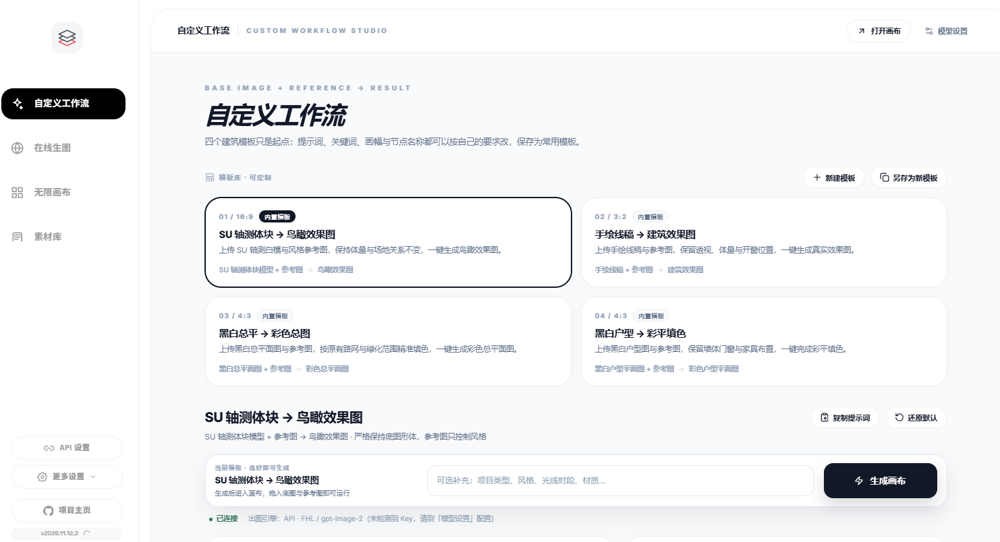

<div align="center">

<p>
  <a href="README.md">简体中文</a> ·
  <a href="README.en.md">English</a> ·
  <a href="README.fr.md">Français</a> ·
  <b>Español</b> ·
  <a href="README.ru.md">Русский</a> ·
  <a href="README.ko.md">한국어</a> ·
  <a href="README.ja.md">日本語</a>
</p>

# Lienzo infinito

**Ideas, generación y archivo: todo en un solo lienzo.**

Un estudio de creación con IA que se ejecuta en local: flujos personalizados, estudio online, lienzo infinito y biblioteca de recursos — cuatro módulos, un solo flujo.<br />
Sin instalación · Funciona sin conexión · Tus datos se quedan en tu equipo

<br />

<a href="https://iorlchoate.github.io/infinite-canvas-site/"></a>&nbsp;&nbsp;
<a href="https://github.com/Iorlchoate/Infinite-Canvas-UDG/releases/latest"></a>&nbsp;&nbsp;
<a href="#inicio-rápido"></a>

</div>


## Inicio rápido

1. Abre [Releases](https://github.com/Iorlchoate/Infinite-Canvas-UDG/releases/latest) y descarga el último `Infinite-Canvas-UDG-<version>-win.zip`
2. Descomprime donde quieras y haz doble clic en **`start.bat`** — el navegador se abre solo (`127.0.0.1:3000`; si el puerto está ocupado, pasa al siguiente)
3. Entra en **API Settings**, pega una clave API, guarda y empieza a crear

> El paquete portátil incluye Python y todas las dependencias offline: **no hay que instalar Python ni configurar nada, y funciona sin conexión**.
> Conserva las carpetas `python/` y `packages/` después de descomprimir.

## Acceso desde móvil y tablet

No hace falta instalar ninguna app en la misma Wi-Fi: abre la dirección LAN que muestra la consola después de `start.bat`:

```text
Same Wi-Fi (phone/tablet): http://192.168.x.x:3000/
```

| Dispositivo | Navegador | Pasos recomendados |
| --- | --- | --- |
| Android móvil | Chrome / Edge | Abrir la dirección → menú «Añadir a pantalla de inicio» → pantalla completa |
| Android tablet | Chrome / Edge | Abrir en horizontal; arrastrar nodos con un dedo, pellizcar para zoom |
| iPhone | Safari | Abrir la dirección → Compartir → «Añadir a pantalla de inicio» |
| iPad | Safari | Abrir en horizontal; Compartir → «Añadir a pantalla de inicio» |

**Táctil:** un dedo para arrastrar nodos / desplazar el lienzo, dos dedos para hacer zoom, doble toque para editar. Las páginas de lienzo se disfrutan mejor en horizontal.

**Si no abre:** comprueba que ambos dispositivos están en la misma Wi-Fi (no red de invitados ni datos móviles), usa la dirección `192.168.x.x` de la consola en lugar de `127.0.0.1`, permite Python en el Firewall de Windows y desactiva VPN / aislamiento AP del router.

> Los datos, recursos y claves API se quedan en el PC. Si el PC se apaga o la app se cierra, el móvil o la tablet no podrán acceder. El acceso remoto requiere un túnel o mapeo de puertos, bajo tu responsabilidad. Aún no hay APK / IPA nativo.

## Por qué local

| Sin cuenta | Sin subidas | Sin configuración |
| --- | --- | --- |
| Sin registro ni espacio en la nube | Recursos, historial y claves se quedan en tu equipo | Descomprimir, doble clic, crear |

La aplicación solo contacta con la API que configures, y solo cuando llamas explícitamente a un modelo en la nube.

## Cuatro módulos, un solo flujo

| Módulo | En una línea |
| --- | --- |
| **Flujos personalizados** | Cuatro plantillas de arquitectura con título, formato, nodos y prompts editables; sustitución de palabras clave, duplicado y restauración |
| **Estudio online** | De 1 a 9 imágenes de referencia, numeradas como IMAGE, para citarlas directamente en el prompt |
| **Lienzo infinito** | Nodos libres y conexiones; texto→imagen, imagen→imagen, retoque local, extensión y cuadrículas multivista |
| **Biblioteca de recursos** | Grupos, orden por lotes, categorías inteligentes; extensión de Chrome y conector de Photoshop |

## Capturas de pantalla

| Flujos personalizados | Estudio online | Biblioteca de recursos |
| --- | --- | --- |
|  |  |  |

## Novedades

- **Guías de alineación**: imán de 7 px al arrastrar / redimensionar, guías azules discontinuas, `Ctrl / ⌘` para suspenderlas
- **Contenedores de grupo**: cabecera de 52 px, ajuste automático, orden en cuadrícula según proporción, renombrar con doble clic, barra flotante (descargar / unir en imagen larga / desagrupar)
- **Culling del lienzo**: a partir de 60 nodos solo se montan las tarjetas cercanas; un lienzo de 300 nodos monta 3 tarjetas en el primer render y las añade al desplazarse

## Para quién

- Arquitectos y diseñadores que quieren **referencia → generación → selección → archivo** en una sola pantalla
- Quienes usan APIs de imagen sin querer entregar recursos y claves a un espacio en la nube
- Equipos que necesitan una biblioteca local con conectores de Photoshop / Chrome

## Documentación

| Contenido | Enlace |
| --- | --- |
| Sitio del proyecto | <https://iorlchoate.github.io/infinite-canvas-site/> |
| Descarga e instalación | [Releases](https://github.com/Iorlchoate/Infinite-Canvas-UDG/releases/latest) |
| Notas de versión | [update-notes.json](https://github.com/Iorlchoate/Infinite-Canvas-UDG/blob/main/update-notes.json) |
| Problemas | [GitHub Issues](https://github.com/Iorlchoate/Infinite-Canvas-UDG/issues) |
| Proyecto original | [hero8152/Infinite-Canvas](https://github.com/hero8152/Infinite-Canvas) |

<details>
<summary><b>macOS / Linux y ejecución desde el código</b></summary>

<br />

**macOS / Linux**

```bash
pip3 install -r requirements.txt
python3 main.py
```

O ejecuta `mac-启动服务.sh`; en macOS, ejecuta primero `mac-修复权限.command` si aparecen avisos de permisos.

**Desde el código (Windows)**

```bash
git clone https://github.com/Iorlchoate/Infinite-Canvas-UDG.git
cd Infinite-Canvas-UDG
start.bat
```

</details>

<details>
<summary><b>Estructura del repositorio y publicación (mantenedores)</b></summary>

<br />

```text
main.py                 # Backend FastAPI
static/                 # Páginas front-end (lienzo / recursos / ajustes)
static/js/              # Scripts front-end
data/                   # Datos de ejecución (lienzos, recursos, config)
tools/                  # Extensiones Chrome / Photoshop, scripts de publicación
packages/               # Dependencias offline
python/                 # Runtime Python portátil para Windows
start.bat               # Entrada en Windows (dependencias + puerto)
```

No publiques nunca una carpeta que ya se haya ejecutado: contiene `API/.env`, `history.json`, `assets/` y `data/`. Usa los scripts de empaquetado:

```bash
python tools/make_release_zip.py
# dist/Infinite-Canvas-UDG-<version>-win.zip

python tools/make_release_dir.py
# dist/Infinite-Canvas-UDG-<version>-publish/
```

</details>

## FAQ

<details>
<summary><b>¿Es gratis? ¿Puedo usarlo comercialmente?</b></summary>
Es gratis y open source con atribución. El proyecto original Infinite-Canvas tiene registro de copyright; sus condiciones (mantener abiertas las derivadas, citar al autor original, no reempaquetar como producto comercial cerrado) siguen aplicando al código original.
</details>

<details>
<summary><b>¿Se suben mis imágenes y mi clave API?</b></summary>
No. Recursos, historial y claves se quedan en tu equipo. La aplicación solo contacta con la API configurada cuando llamas a un modelo en la nube.
</details>

<details>
<summary><b>¿Y si el puerto está ocupado o faltan dependencias?</b></summary>
El puerto pasa a 3001, 3002, etc.; define <code>CANVAS_PORT</code> para fijarlo. Si faltan dependencias, <code>start.bat</code> las reinstala offline desde <code>packages/</code>.
</details>

## Open source y créditos

Basado en el proyecto open source [Infinite-Canvas](https://github.com/hero8152/Infinite-Canvas) de **wuli大雄**, con atribución y bajo las mismas condiciones open source.

El proyecto original dejó de actualizarse el 28/08/2026 y no está afiliado a este proyecto.

- Autor: [Bilibili](https://space.bilibili.com/78652351) · Nuevo proyecto: [DX-OS](http://www.DX-OS.com)
- Tutorial en vídeo: [YouTube](https://youtu.be/1y9ShTvgC_w)
- Extensión de Chrome: [Instalar](https://chromewebstore.google.com/detail/infinite-canvas-%E5%9B%BE%E5%83%8F%E8%A7%86%E9%A2%91%E6%96%87%E5%AD%97%E6%8A%93%E5%8F%96%E5%B7%A5/ajfhnbklbmpfaaookhfakohabnpmlcic)

<div align="center">

**Abre el lienzo. Empieza a crear.**

[Sitio](https://iorlchoate.github.io/infinite-canvas-site/) · [Descargar](https://github.com/Iorlchoate/Infinite-Canvas-UDG/releases/latest) · [Issues](https://github.com/Iorlchoate/Infinite-Canvas-UDG/issues)

</div>
