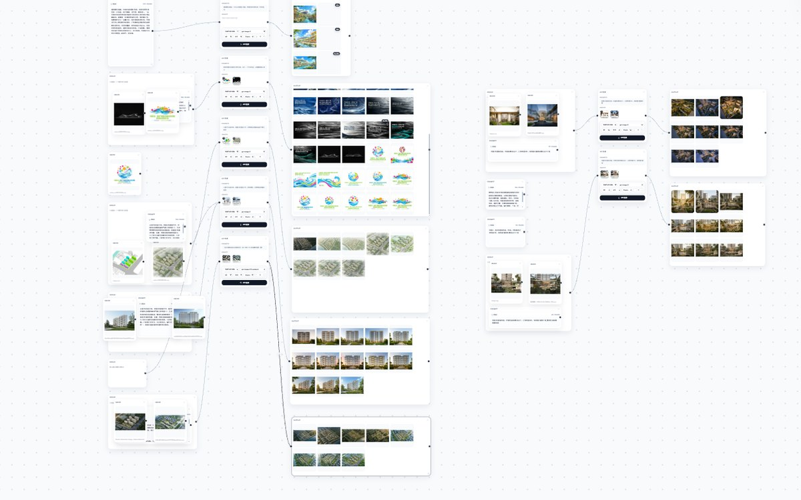

<div align="center">

<p>
  <a href="README.md">简体中文</a> ·
  <a href="README.en.md">English</a> ·
  <b>Français</b> ·
  <a href="README.es.md">Español</a> ·
  <a href="README.ru.md">Русский</a> ·
  <a href="README.ko.md">한국어</a> ·
  <a href="README.ja.md">日本語</a>
</p>

# Toile infinie

**Des idées, de la génération et de l'archivage — sur une seule toile.**

Un atelier de création IA local-first : workflows personnalisés, studio en ligne, toile infinie et bibliothèque d'assets — quatre modules, un seul flux.<br />
Sans installation · Fonctionne hors ligne · Vos données restent sur votre machine

<br />

<a href="https://iorlchoate.github.io/infinite-canvas-site/"></a>
<a href="https://github.com/Iorlchoate/Infinite-Canvas-UDG/releases/latest"></a>
<a href="#démarrage-rapide"></a>

<br />


</div>


## Démarrage rapide

1. Ouvrez [Releases](https://github.com/Iorlchoate/Infinite-Canvas-UDG/releases/latest) et téléchargez le dernier `Infinite-Canvas-UDG-<version>-win.zip`
2. Décompressez où vous voulez et double-cliquez sur **`start.bat`** — le navigateur s'ouvre tout seul (`127.0.0.1:3000`, le port passe au suivant s'il est occupé)
3. Ouvrez **API Settings**, collez une clé API, enregistrez, puis créez

> La version portable embarque Python et toutes les dépendances hors ligne : **aucune installation de Python, aucun environnement à configurer, fonctionne hors ligne**.
> Conservez les dossiers `python/` et `packages/` après décompression.

## Pourquoi en local

| Pas de compte | Pas d'envoi | Pas de configuration |
| --- | --- | --- |
| Aucun compte, aucun espace cloud | Assets, historique et clés restent chez vous | Décompresser, double-cliquer, créer |

L'application ne contacte que l'API que vous configurez, et uniquement lorsque vous appelez explicitement un modèle cloud.

## Quatre modules, un seul flux

| Module | En une ligne |
| --- | --- |
| **Workflows personnalisés** | Quatre modèles d'architecture modifiables (titre, format, nœuds, prompts) ; remplacement de mots-clés, duplication et restauration |
| **Studio en ligne** | 1 à 9 images de référence, numérotées IMAGE, pour les citer directement dans le prompt |
| **Toile infinie** | Nœuds libres et connexions ; texte→image, image→image, retouche locale, extension et grilles multi-vues |
| **Bibliothèque d'assets** | Groupes, tri par lots, catégories intelligentes ; extensions Chrome et connecteur Photoshop |

<details>
<summary><b>Plus de captures</b></summary>

<br />

**Toile infinie · workflow**



**Studio en ligne**


**Bibliothèque d'assets**


</details>

## Dernières nouveautés

- **Repères d'alignement** : aimantation à 7 px lors du déplacement / redimensionnement, guides bleus en pointillés, `Ctrl / ⌘` pour suspendre
- **Conteneurs de groupe** : en-tête de 52 px, ajustement automatique, rangement en grille selon le ratio, renommage par double-clic, barre flottante (télécharger / fusionner en image longue / dissocier)
- **Culling de la toile** : à partir de 60 nœuds, seules les cartes proches sont montées ; une toile de 300 nœuds monte 3 cartes au premier rendu, puis les ajoute pendant le déplacement
- Notes de reverse-engineering : [Recherche sur la toile DX OS](docs/canvas-alignment-and-grouping-research.md)

## Pour qui ?

- Architectes et designers qui veulent **référence → génération → sélection → archivage** sur un seul écran
- Ceux qui utilisent des API d'image sans confier assets et clés à un espace cloud
- Les équipes qui ont besoin d'une bibliothèque locale avec connecteurs Photoshop / Chrome

## Documentation

| Contenu | Lien |
| --- | --- |
| Site du projet | <https://iorlchoate.github.io/infinite-canvas-site/> |
| Téléchargement | [Releases](https://github.com/Iorlchoate/Infinite-Canvas-UDG/releases/latest) |
| Notes de version | [update-notes.json](https://github.com/Iorlchoate/Infinite-Canvas-UDG/blob/main/update-notes.json) |
| Signaler un problème | [GitHub Issues](https://github.com/Iorlchoate/Infinite-Canvas-UDG/issues) |
| Projet amont | [hero8152/Infinite-Canvas](https://github.com/hero8152/Infinite-Canvas) |

<details>
<summary><b>macOS / Linux, tablette et exécution depuis les sources</b></summary>

<br />

**macOS / Linux**

```bash
pip3 install -r requirements.txt
python3 main.py
```

Ou lancez `mac-启动服务.sh` ; sur macOS, exécutez d'abord `mac-修复权限.command` en cas de problème de permissions.

**Téléphone / tablette**

Sur le même Wi-Fi, ouvrez l'adresse LAN affichée dans la console. Le glissement à un doigt et le zoom à deux doigts sont pris en charge ; ajoutez la page à l'écran d'accueil pour le plein écran. Le PC doit rester allumé.

**Depuis les sources (Windows)**

```bash
git clone https://github.com/Iorlchoate/Infinite-Canvas-UDG.git
cd Infinite-Canvas-UDG
start.bat
```

</details>

<details>
<summary><b>Structure du dépôt et publication (mainteneurs)</b></summary>

<br />

```text
main.py                 # Backend FastAPI
static/                 # Pages front-end (toile / assets / réglages)
static/js/              # Scripts front-end
data/                   # Données d'exécution (toiles, assets, config)
tools/                  # Extensions Chrome / Photoshop, scripts de publication
packages/               # Roues de dépendances hors ligne
python/                 # Runtime Python portable Windows
start.bat               # Entrée Windows (vérification des dépendances + port)
```

Ne publiez jamais un dossier qui a déjà tourné : il contient `API/.env`, `history.json`, `assets/` et `data/`. Utilisez les scripts de packaging :

```bash
python tools/make_release_zip.py
# dist/Infinite-Canvas-UDG-<version>-win.zip

python tools/make_release_dir.py
# dist/Infinite-Canvas-UDG-<version>-publish/
```

</details>

## FAQ

<details>
<summary><b>Est-ce gratuit ? Puis-je l'utiliser commercialement ?</b></summary>
Le projet est gratuit et open source avec attribution. Le projet amont Infinite-Canvas a un enregistrement de copyright ; ses conditions (garder les dérivés ouverts, créditer l'auteur original, ne pas repackager en closed-source commercial) s'appliquent au code amont.
</details>

<details>
<summary><b>Mes images et ma clé API sont-elles envoyées ?</b></summary>
Non. Assets, historique et clés restent sur votre machine. L'application ne contacte que l'API configurée, lorsque vous appelez un modèle cloud.
</details>

<details>
<summary><b>Le port est occupé ou des dépendances manquent ?</b></summary>
Le port passe à 3001, 3002, etc. ; définissez <code>CANVAS_PORT</code> pour le fixer. Si des dépendances manquent, <code>start.bat</code> les réinstalle hors ligne depuis <code>packages/</code>.
</details>

## Open source et crédits

Basé sur le projet open source [Infinite-Canvas](https://github.com/hero8152/Infinite-Canvas) de **wuli大雄**, avec attribution et sous les mêmes conditions open source.

Le projet amont n'est plus mis à jour depuis le 28/08/2026 et n'est pas affilié à ce projet.

- Auteur : [Bilibili](https://space.bilibili.com/78652351) · Nouveau projet : [DX-OS](http://www.DX-OS.com)
- Tutoriel vidéo : [YouTube](https://youtu.be/1y9ShTvgC_w)
- Extension Chrome : [Installer](https://chromewebstore.google.com/detail/infinite-canvas-%E5%9B%BE%E5%83%8F%E8%A7%86%E9%A2%91%E6%96%87%E5%AD%97%E6%8A%93%E5%8F%96%E5%B7%A5/ajfhnbklbmpfaaookhfakohabnpmlcic)

<div align="center">

**Ouvrez la toile. Créez.**

[Site](https://iorlchoate.github.io/infinite-canvas-site/) · [Télécharger](https://github.com/Iorlchoate/Infinite-Canvas-UDG/releases/latest) · [Issues](https://github.com/Iorlchoate/Infinite-Canvas-UDG/issues)

</div>
