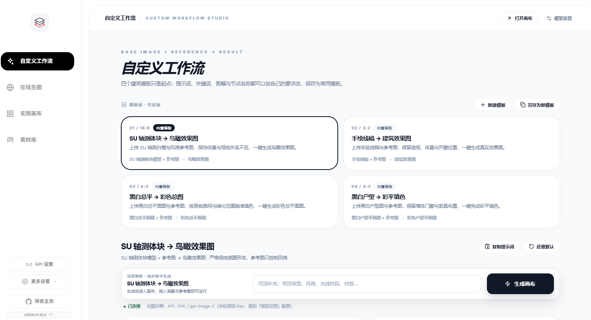

<div align="center">

<p>
  <a href="README.md">简体中文</a> ·
  <a href="README.en.md">English</a> ·
  <a href="README.fr.md">Français</a> ·
  <a href="README.es.md">Español</a> ·
  <a href="README.ru.md">Русский</a> ·
  <a href="README.ko.md">한국어</a> ·
  <b>日本語</b>
</p>

# 無限キャンバス

**アイデアも、生成も、蓄積も。すべてを一枚のキャンバスに。**

ローカルで動く AI 制作ワークベンチ：カスタムワークフロー、オンライン生成、無限キャンバス、素材ライブラリ。4つのモジュールを1つの流れに。<br />
インストール不要 · オフライン起動 · データは手元に

<br />

<a href="https://iorlchoate.github.io/infinite-canvas-site/"></a>&nbsp;&nbsp;
<a href="https://github.com/Iorlchoate/Infinite-Canvas-UDG/releases/latest"></a>&nbsp;&nbsp;
<a href="#クイックスタート"></a>

</div>


## クイックスタート

1. [Releases](https://github.com/Iorlchoate/Infinite-Canvas-UDG/releases/latest) から最新の `Infinite-Canvas-UDG-<version>-win.zip` をダウンロード
2. 任意のフォルダに解凍し、**`start.bat`** をダブルクリック — ブラウザが自動で開きます（`127.0.0.1:3000`、使用中なら次のポートへ）
3. **API Settings** で API キーを入力して保存すれば、すぐに制作を開始できます

> ポータブル版には Python とオフライン依存関係がすべて入っています：**Python のインストールも環境設定も不要、オフラインでも起動できます**。
> 解凍後は `python/` と `packages/` フォルダを残してください。

## スマートフォン / タブレットからのアクセス

同じ Wi-Fi ならアプリのインストールは不要です。`start.bat` 実行後にコンソールへ表示される LAN アドレスをブラウザで開きます:

```text
Same Wi-Fi (phone/tablet): http://192.168.x.x:3000/
```

| 端末 | ブラウザ | おすすめの手順 |
| --- | --- | --- |
| Android スマートフォン | Chrome / Edge | アドレスを開く → メニュー「ホーム画面に追加」→ 全画面 |
| Android タブレット | Chrome / Edge | 横向きで開く。1本指でノード移動、2本指でズーム |
| iPhone | Safari | アドレスを開く → 共有 → 「ホーム画面に追加」 |
| iPad | Safari | 横向きで開く。共有 → 「ホーム画面に追加」 |

**タッチ操作**：1本指でノード / キャンバスを移動、2本指でピンチズーム、ダブルタップで編集。キャンバス系ページは横向きが快適です。

**開けない場合**：同じ Wi-Fi か（ゲストネットワーク / モバイル通信でないか）、`127.0.0.1` ではなくコンソールの `192.168.x.x` を使っているかを確認してください。Windows ファイアウォールで Python を許可し、VPN / ルーターの AP 分離をオフにします。

> データ、素材、API キーは PC 上に残ります。PC の電源が切れたりアプリを終了すると、スマートフォン / タブレットからはアクセスできません。外部ネットワークからのアクセスにはトンネルやポートマッピングが必要で、自己責任となります。ネイティブ APK / IPA は未提供です。

## なぜローカルか

| アカウント不要 | アップロード不要 | 設定不要 |
| --- | --- | --- |
| 登録もクラウドワークスペースもなし | 素材・履歴・API キーは手元に | 解凍してダブルクリックするだけ |

アプリが接続するのは、自分で設定した API だけです。クラウドモデルを明示的に呼び出したときだけ通信します。

## 4つのモジュール、1つの流れ

| モジュール | ひとことで |
| --- | --- |
| **カスタムワークフロー** | 4つの建築テンプレート。タイトル・比率・ノード・プロンプトを編集可能。キーワード一括置換、複製、初期化に対応 |
| **オンライン生成** | 1〜9枚の参照画像に IMAGE 番号を付け、プロンプトから直接指定 |
| **無限キャンバス** | ノードを自由に配置して接続。テキスト→画像、画像→画像、部分修正、拡張、マルチビューグリッド |
| **素材ライブラリ** | グループ管理、一括整理、スマート分類。Chrome 収集拡張と Photoshop コネクタ |

## 画面プレビュー

**カスタムワークフロー**



**オンライン生成**


**素材ライブラリ**


## 最近の更新

- **キャンバスの整列ガイド**：ドラッグ / リサイズ時に 7px の画面基準でスナップ、青い破線ガイド、`Ctrl / ⌘` で一時解除
- **グループコンテナ**：52px ヘッダー、自動フィット、比率に応じたグリッド整理、ダブルクリックで名前変更、フローティングツールバー（ダウンロード / 長い画像に結合 / グループ解除）
- **大型キャンバスのビューポートカリング**：60 ノード以上では画面付近のカードだけをマウント。300 ノードのキャンバスは初回描画で 3 枚だけをマウントし、移動に合わせて追加

## こんな人に

- **参照 → 生成 → 選別 → アーカイブ** を 1 画面で完結させたい建築家・デザイナー
- 画像 API を使いつつ、素材やキーをクラウドに預けたくない人
- Photoshop / Chrome コネクタ付きのローカル素材ライブラリが必要なチーム

## ドキュメント

| 内容 | リンク |
| --- | --- |
| プロジェクトサイト | <https://iorlchoate.github.io/infinite-canvas-site/> |
| ダウンロードとインストール | [Releases](https://github.com/Iorlchoate/Infinite-Canvas-UDG/releases/latest) |
| 更新ノート | [update-notes.json](https://github.com/Iorlchoate/Infinite-Canvas-UDG/blob/main/update-notes.json) |
| 問題報告 | [GitHub Issues](https://github.com/Iorlchoate/Infinite-Canvas-UDG/issues) |
| 上流プロジェクト | [hero8152/Infinite-Canvas](https://github.com/hero8152/Infinite-Canvas) |

<details>
<summary><b>macOS / Linux、ソースからの実行</b></summary>

<br />

**macOS / Linux**

```bash
pip3 install -r requirements.txt
python3 main.py
```

または `mac-启动服务.sh` を実行します。macOS で権限の確認が出る場合は、先に `mac-修复权限.command` を実行してください。

**ソースから実行（Windows）**

```bash
git clone https://github.com/Iorlchoate/Infinite-Canvas-UDG.git
cd Infinite-Canvas-UDG
start.bat
```

</details>

<details>
<summary><b>リポジトリ構成とリリース（メンテナー向け）</b></summary>

<br />

```text
main.py                 # FastAPI バックエンド
static/                 # フロントエンド（キャンバス / 素材 / 設定）
static/js/              # フロントエンドスクリプト
data/                   # 実行データ（キャンバス、素材、設定）
tools/                  # Chrome / Photoshop 拡張、リリーススクリプト
packages/               # オフライン依存パッケージ
python/                 # Windows ポータブル Python ランタイム
start.bat               # Windows 起動入口（依存確認 + ポート）
```

実行済みの作業フォルダをそのまま配布しないでください。`API/.env`、`history.json`、`assets/`、`data/` が含まれます。パッケージングスクリプトを使ってください：

```bash
python tools/make_release_zip.py
# dist/Infinite-Canvas-UDG-<version>-win.zip

python tools/make_release_dir.py
# dist/Infinite-Canvas-UDG-<version>-publish/
```

</details>

## FAQ

<details>
<summary><b>無料ですか？商用利用できますか？</b></summary>
無料のオープンソースで、出典表示が必要です。上流の Infinite-Canvas には著作権登録があり、上流コードには元プロジェクトの条件（派生版の公開、原作者の表示、クローズドな商用再パッケージの禁止）が引き続き適用されます。
</details>

<details>
<summary><b>画像や API キーはアップロードされますか？</b></summary>
いいえ。素材、履歴、キーは手元に残ります。アプリはクラウドモデルを明示的に呼び出したときだけ、設定した API と通信します。
</details>

<details>
<summary><b>ポートが使用中、または依存関係が足りない場合は？</b></summary>
ポートは 3001、3002 と自動で移動します。固定するには <code>CANVAS_PORT</code> を設定してください。依存関係が足りない場合、<code>start.bat</code> が <code>packages/</code> からオフラインで再インストールします。
</details>

## オープンソースと謝辞

**wuli大雄** のオープンソースプロジェクト [Infinite-Canvas](https://github.com/hero8152/Infinite-Canvas) をベースに、出典を明記し、同じオープンソース条件で公開しています。

上流プロジェクトは 2026/08/28 に更新を停止しており、本プロジェクトとは所属関係がありません。

- 作者：[Bilibili](https://space.bilibili.com/78652351) · 新プロジェクト：[DX-OS](http://www.DX-OS.com)
- 動画チュートリアル：[YouTube](https://youtu.be/1y9ShTvgC_w)
- Chrome 拡張：[インストール](https://chromewebstore.google.com/detail/infinite-canvas-%E5%9B%BE%E5%83%8F%E8%A7%86%E9%A2%91%E6%96%87%E5%AD%97%E6%8A%93%E5%8F%96%E5%B7%A5/ajfhnbklbmpfaaookhfakohabnpmlcic)

<div align="center">

**キャンバスを開いて、制作を始めよう。**

[サイト](https://iorlchoate.github.io/infinite-canvas-site/) · [ダウンロード](https://github.com/Iorlchoate/Infinite-Canvas-UDG/releases/latest) · [Issues](https://github.com/Iorlchoate/Infinite-Canvas-UDG/issues)

</div>
