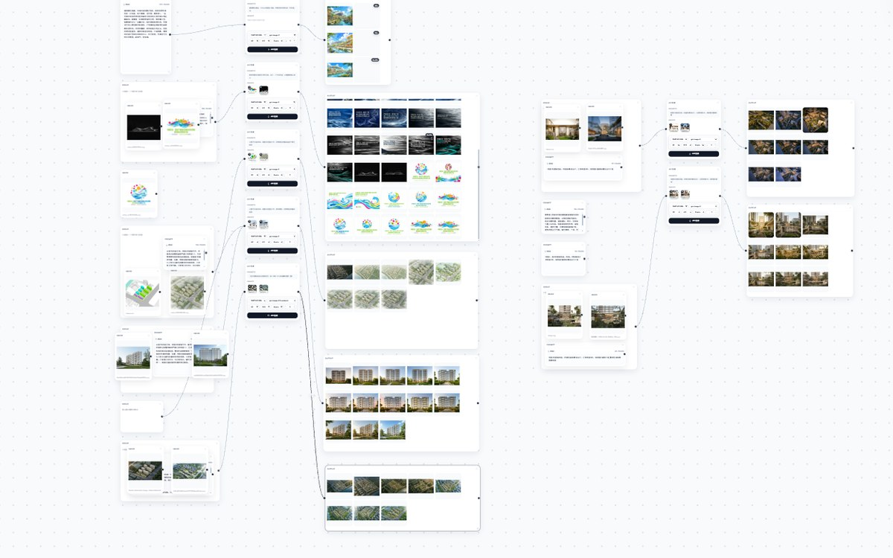

<div align="center">

<p>
  <a href="README.md">简体中文</a> ·
  <a href="README.en.md">English</a> ·
  <a href="README.fr.md">Français</a> ·
  <a href="README.es.md">Español</a> ·
  <a href="README.ru.md">Русский</a> ·
  <b>한국어</b> ·
  <a href="README.ja.md">日本語</a>
</p>

# 무한 캔버스

**아이디어, 생성, 아카이브를 하나의 캔버스에.**

내 컴퓨터에서 실행되는 AI 창작 워크벤치: 커스텀 워크플로, 온라인 스튜디오, 무한 캔버스, 에셋 라이브러리 — 네 모듈, 하나의 흐름.<br />
설치 불필요 · 오프라인 실행 · 데이터는 로컬에

<br />

<a href="https://iorlchoate.github.io/infinite-canvas-site/"></a>
<a href="https://github.com/Iorlchoate/Infinite-Canvas-UDG/releases/latest"></a>
<a href="#빠른-시작"></a>

<br />


</div>


## 빠른 시작

1. [Releases](https://github.com/Iorlchoate/Infinite-Canvas-UDG/releases/latest)에서 최신 `Infinite-Canvas-UDG-<version>-win.zip`을 다운로드합니다
2. 원하는 폴더에 압축을 풀고 **`start.bat`**을 더블 클릭합니다 — 브라우저가 자동으로 열립니다 (`127.0.0.1:3000`, 포트가 사용 중이면 자동으로 다음 포트로 이동)
3. **API Settings**에서 API 키를 입력하고 저장한 뒤 바로 생성합니다

> 포터블 패키지에는 Python과 모든 오프라인 의존성이 포함되어 있습니다: **Python 설치, 환경 설정, 인터넷 연결 없이도 실행됩니다**.
> 압축을 푼 뒤 `python/`과 `packages/` 폴더를 유지하세요.

## 왜 로컬인가

| 계정 없음 | 업로드 없음 | 설정 없음 |
| --- | --- | --- |
| 가입도, 클라우드 워크스페이스도 없음 | 에셋, 기록, API 키가 내 컴퓨터에 남음 | 압축 풀고 더블 클릭하면 끝 |

앱은 직접 설정한 API 주소에만 연결하며, 클라우드 모델을 직접 호출할 때만 통신합니다.

## 네 개의 모듈, 하나의 흐름

| 모듈 | 한 줄 설명 |
| --- | --- |
| **커스텀 워크플로** | 네 가지 건축 템플릿의 제목, 비율, 노드, 프롬프트를 수정 가능; 키워드 일괄 치환, 복제, 초기화 |
| **온라인 스튜디오** | 1–9장의 레퍼런스 이미지에 IMAGE 번호를 붙여 프롬프트에서 바로 지칭 |
| **무한 캔버스** | 노드 자유 배치와 연결; 텍스트→이미지, 이미지→이미지, 부분 수정, 확장, 다중 뷰 그리드 |
| **에셋 라이브러리** | 그룹, 일괄 정리, 스마트 분류; Chrome 수집 확장과 Photoshop 커넥터 |

<details>
<summary><b>더 많은 화면</b></summary>

<br />

**무한 캔버스 · 워크플로**



**온라인 스튜디오**


**에셋 라이브러리**


</details>

## 최근 업데이트

- **캔버스 정렬 가이드**: 드래그 / 크기 조절 시 7px 화면 기준 스냅, 파란 점선 가이드, `Ctrl / ⌘`로 일시 해제
- **그룹 컨테이너**: 52px 헤더, 자동 맞춤, 비율 기반 그리드 정리, 더블 클릭 이름 변경, 플로팅 툴바(다운로드 / 긴 이미지 합치기 / 그룹 해제)
- **대형 캔버스 뷰포트 컬링**: 노드가 60개 이상이면 화면 근처 카드만 마운트; 300개 캔버스는 첫 렌더에서 3개만 마운트하고 이동 시 점진적으로 추가
- 전체 리버스 엔지니어링 기록: [DX OS 캔버스 연구](docs/canvas-alignment-and-grouping-research.md)

## 누구를 위한가

- **레퍼런스 → 생성 → 선별 → 아카이브**를 한 화면에서 하고 싶은 건축가와 디자이너
- 이미지 API를 쓰지만 에셋과 키를 클라우드에 맡기고 싶지 않은 사람
- Photoshop / Chrome 커넥터가 있는 로컬 에셋 라이브러리가 필요한 팀

## 문서

| 내용 | 링크 |
| --- | --- |
| 프로젝트 사이트 | <https://iorlchoate.github.io/infinite-canvas-site/> |
| 다운로드 및 설치 | [Releases](https://github.com/Iorlchoate/Infinite-Canvas-UDG/releases/latest) |
| 업데이트 노트 | [update-notes.json](https://github.com/Iorlchoate/Infinite-Canvas-UDG/blob/main/update-notes.json) |
| 문제 제보 | [GitHub Issues](https://github.com/Iorlchoate/Infinite-Canvas-UDG/issues) |
| 원본 프로젝트 | [hero8152/Infinite-Canvas](https://github.com/hero8152/Infinite-Canvas) |

<details>
<summary><b>macOS / Linux, 태블릿, 소스 실행</b></summary>

<br />

**macOS / Linux**

```bash
pip3 install -r requirements.txt
python3 main.py
```

또는 `mac-启动服务.sh`를 실행합니다. macOS에서 권한 안내가 나오면 먼저 `mac-修复权限.command`를 실행하세요.

**휴대폰 / 태블릿**

같은 Wi-Fi에서 콘솔에 출력된 LAN 주소를 브라우저로 엽니다. 한 손가락 드래그와 두 손가락 확대/축소를 지원하며, 홈 화면에 추가하면 전체 화면으로 사용할 수 있습니다. PC는 켜져 있어야 합니다.

**소스에서 실행 (Windows)**

```bash
git clone https://github.com/Iorlchoate/Infinite-Canvas-UDG.git
cd Infinite-Canvas-UDG
start.bat
```

</details>

<details>
<summary><b>저장소 구조와 배포 (메인테이너)</b></summary>

<br />

```text
main.py                 # FastAPI 백엔드
static/                 # 프런트엔드 페이지 (캔버스 / 에셋 / 설정)
static/js/              # 프런트엔드 스크립트
data/                   # 실행 데이터 (캔버스, 에셋, 설정)
tools/                  # Chrome / Photoshop 확장, 배포 스크립트
packages/               # 오프라인 의존성
python/                 # Windows 포터블 Python 런타임
start.bat               # Windows 시작점 (의존성 확인 + 포트)
```

실행한 작업 폴더를 그대로 배포하지 마세요. `API/.env`, `history.json`, `assets/`, `data/`가 포함됩니다. 패키징 스크립트를 사용하세요:

```bash
python tools/make_release_zip.py
# dist/Infinite-Canvas-UDG-<version>-win.zip

python tools/make_release_dir.py
# dist/Infinite-Canvas-UDG-<version>-publish/
```

</details>

## FAQ

<details>
<summary><b>무료인가요? 상업적으로 사용할 수 있나요?</b></summary>
무료이며 출처를 표시하는 오픈 소스입니다. 원본 Infinite-Canvas에는 저작권 등록이 있으며, 원본 코드에는 원 프로젝트의 조건(파생물 공개, 원작자 표시, 폐쇄형 상업 재패키징 금지)이 계속 적용됩니다.
</details>

<details>
<summary><b>이미지와 API 키가 업로드되나요?</b></summary>
아니요. 에셋, 기록, 키는 내 컴퓨터에 남습니다. 앱은 클라우드 모델을 직접 호출할 때만 설정한 API와 통신합니다.
</details>

<details>
<summary><b>포트가 사용 중이거나 의존성이 없으면 어떻게 하나요?</b></summary>
포트는 3001, 3002로 자동 이동합니다. 고정하려면 <code>CANVAS_PORT</code>를 설정하세요. 의존성이 없으면 <code>start.bat</code>이 <code>packages/</code>에서 오프라인으로 다시 설치합니다.
</details>

## 오픈 소스와 감사

**wuli大雄**의 오픈 소스 프로젝트 [Infinite-Canvas](https://github.com/hero8152/Infinite-Canvas)를 기반으로 하며, 출처를 표시하고 같은 오픈 소스 조건을 따릅니다.

원본 프로젝트는 2026/08/28에 업데이트를 중단했으며 이 프로젝트와 소속 관계가 없습니다.

- 작성자: [Bilibili](https://space.bilibili.com/78652351) · 새 프로젝트: [DX-OS](http://www.DX-OS.com)
- 동영상 튜토리얼: [YouTube](https://youtu.be/1y9ShTvgC_w)
- Chrome 확장: [설치](https://chromewebstore.google.com/detail/infinite-canvas-%E5%9B%BE%E5%83%8F%E8%A7%86%E9%A2%91%E6%96%87%E5%AD%97%E6%8A%93%E5%8F%96%E5%B7%A5/ajfhnbklbmpfaaookhfakohabnpmlcic)

<div align="center">

**캔버스를 열고, 만들기 시작하세요.**

[사이트](https://iorlchoate.github.io/infinite-canvas-site/) · [다운로드](https://github.com/Iorlchoate/Infinite-Canvas-UDG/releases/latest) · [Issues](https://github.com/Iorlchoate/Infinite-Canvas-UDG/issues)

</div>
