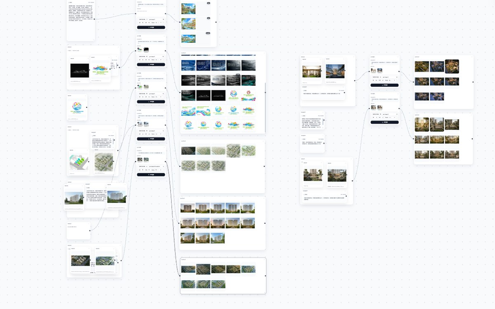

<div align="center">

<p>
  <b>简体中文</b> ·
  <a href="README.en.md">English</a> ·
  <a href="README.fr.md">Français</a> ·
  <a href="README.es.md">Español</a> ·
  <a href="README.ru.md">Русский</a> ·
  <a href="README.ko.md">한국어</a> ·
  <a href="README.ja.md">日本語</a>
</p>

# 无限画布 · Infinite Canvas

**把想法、生成与沉淀，都放进一张无限画布。**

本地运行的 AI 创作工作台：自定义工作流、在线生图、无限画布、素材库，四个模块串成一条链路。<br />
免安装 · 断网可启动 · 数据留在本机

<br />

<a href="https://iorlchoate.github.io/infinite-canvas-site/"></a>
<a href="https://github.com/Iorlchoate/Infinite-Canvas-UDG/releases/latest"></a>
<a href="#一分钟开始"></a>

<br />


</div>


## 一分钟开始

1. 打开 [Releases](https://github.com/Iorlchoate/Infinite-Canvas-UDG/releases/latest)，下载最新的 `Infinite-Canvas-UDG-<版本>-win.zip`
2. 解压到任意目录，双击 **`start.bat`**，浏览器会自动打开（默认 `127.0.0.1:3000`，端口占用自动顺延）
3. 进入「API 设置」填入 API Key，保存后即可开始生成

> 绿色包内置便携 Python 与全部离线依赖：**不用装 Python、不用配环境、断网也能启动**。
> 解压后请保留 `python/` 与 `packages/` 目录。

## 为什么是本地

| 不用注册 | 不用上传 | 不用折腾 |
| --- | --- | --- |
| 没有账号、没有云端工作区 | 素材、历史、API Key 都留在本机 | 解压双击即用，依赖已打包 |

只有你主动调用云端模型时，才会与你配置的 API 地址通信。

## 四个模块，一条链路

| 模块 | 一句话 |
| --- | --- |
| **自定义工作流** | 四个建筑模板可改标题、画幅、节点与提示词，支持关键词批量替换、另存与还原 |
| **在线生图** | 参考图 1–9 张自定义，每张带 IMAGE 编号，写 Prompt 时直接指代 |
| **无限画布** | 节点自由摆放、连线组合；文生图 / 图生图 / 局部重绘 / 扩展出图 / 九宫格多视角 |
| **素材库** | 分组管理、批量整理、智能分类；配套 Chrome 采集插件与 Photoshop 直连插件 |

<details>
<summary><b>更多界面截图</b></summary>

<br />

**无限画布 · 工作流**



**在线生图**


**素材库**


</details>

## 最近更新

- **画布对齐吸附**：拖动 / 右下角缩放时按 7px 屏幕阈值吸附，蓝色虚线参考线，`Ctrl / ⌘` 临时关闭
- **分组容器**：52px 标题栏、自动适配、按宽高比网格整理、双击重命名、浮动工具栏（下载 / 合并长图 / 解散）
- **大画布视口裁剪**：节点数 ≥60 时只挂载视口附近卡片，300 节点首屏仅 3 个 DOM；平移缩放增量挂载
- 完整逆向记录：[DX OS 画布研究与改造报告](docs/canvas-alignment-and-grouping-research.md)

## 适合谁

- 需要把 **参考图 → 生成 → 筛选 → 归档** 放在一个屏幕里的建筑 / 设计工作者
- 想用 API 出图，但不想把素材和 Key 交给云端工作区的人
- 需要本地素材库、PS / Chrome 插件衔接的团队

## 文档

| 内容 | 入口 |
| --- | --- |
| 项目介绍网站 | <https://iorlchoate.github.io/infinite-canvas-site/> |
| 下载与安装 | [Releases](https://github.com/Iorlchoate/Infinite-Canvas-UDG/releases/latest) |
| 更新说明 | [update-notes.json](https://github.com/Iorlchoate/Infinite-Canvas-UDG/blob/main/update-notes.json) |
| 问题反馈 | [Issues](https://github.com/Iorlchoate/Infinite-Canvas-UDG/issues) |
| 上游项目 | [hero8152/Infinite-Canvas](https://github.com/hero8152/Infinite-Canvas) |

<details>
<summary><b>macOS / Linux、手机平板、源码运行</b></summary>

<br />

**macOS / Linux**

```bash
pip3 install -r requirements.txt
python3 main.py
```

或使用 `mac-启动服务.sh`；macOS 首次运行如遇权限提示，先执行 `mac-修复权限.command`。

**手机 / 平板**

同一 Wi-Fi 下，用浏览器打开控制台打印的局域网地址即可；支持单指拖动、双指缩放，可「添加到主屏幕」。电脑关机后无法访问。

**源码运行（Windows）**

```bash
git clone https://github.com/Iorlchoate/Infinite-Canvas-UDG.git
cd Infinite-Canvas-UDG
start.bat
```

</details>

<details>
<summary><b>目录结构与发布（维护者）</b></summary>

<br />

```text
main.py                 # FastAPI 后端入口
static/                 # 前端页面（画布 / 素材库 / 设置等）
static/js/              # 前端脚本
data/                   # 运行数据（画布、素材库、配置）
tools/                  # Chrome / Photoshop 插件、端口探测、发布脚本
packages/               # 离线依赖包
python/                 # Windows 便携 Python 运行时
start.bat               # Windows 启动入口（依赖自检 + 端口避让）
```

发布前用打包脚本，**不要直接复制正在运行的工作目录**（会带上 `API/.env`、`history.json`、`assets/`、`data/` 等）：

```bash
python tools/make_release_zip.py
# 输出 dist/Infinite-Canvas-UDG-<版本>-win.zip

python tools/make_release_dir.py
# 输出 dist/Infinite-Canvas-UDG-<版本>-publish/
```

</details>

## 常见问题

<details>
<summary><b>免费吗？可以商用吗？</b></summary>
项目免费，保持开源并注明来源。上游 Infinite-Canvas 已申请著作权，其开源约定（二次开发须保持开源并注明来源作者、禁止擅自商用封装）对上游代码继续适用，请勿擅自封装商用。
</details>

<details>
<summary><b>图片和 API Key 会被上传吗？</b></summary>
不会存到任何服务端。素材、生成历史与 Key 都在本机；只有你主动调用云端模型时，才会与你配置的 API 地址通信。
</details>

<details>
<summary><b>端口被占用 / 提示缺少依赖怎么办？</b></summary>
端口会自动顺延到 3001、3002……，以控制台输出为准；如需固定端口可设置 <code>CANVAS_PORT</code>。依赖丢失时 <code>start.bat</code> 会自动从 <code>packages/</code> 离线补装。
</details>

## 开源与致谢

本项目基于 **wuli大雄** 的开源项目 [Infinite-Canvas](https://github.com/hero8152/Infinite-Canvas) 二次开发，沿用上游开源约定，并注明来源。

上游已于 2026/08/28 停更，与本项目无隶属关系。

- 作者主页：[B 站](https://space.bilibili.com/78652351) · 新版：[DX-OS](http://www.DX-OS.com)
- 视频教程：[YouTube](https://youtu.be/1y9ShTvgC_w)
- Chrome 采集插件：[安装](https://chromewebstore.google.com/detail/infinite-canvas-%E5%9B%BE%E5%83%8F%E8%A7%86%E9%A2%91%E6%96%87%E5%AD%97%E6%8A%93%E5%8F%96%E5%B7%A5/ajfhnbklbmpfaaookhfakohabnpmlcic)

<div align="center">

**把画布打开，开始创作。**

[项目介绍](https://iorlchoate.github.io/infinite-canvas-site/) · [下载最新版](https://github.com/Iorlchoate/Infinite-Canvas-UDG/releases/latest) · [反馈问题](https://github.com/Iorlchoate/Infinite-Canvas-UDG/issues)

</div>
