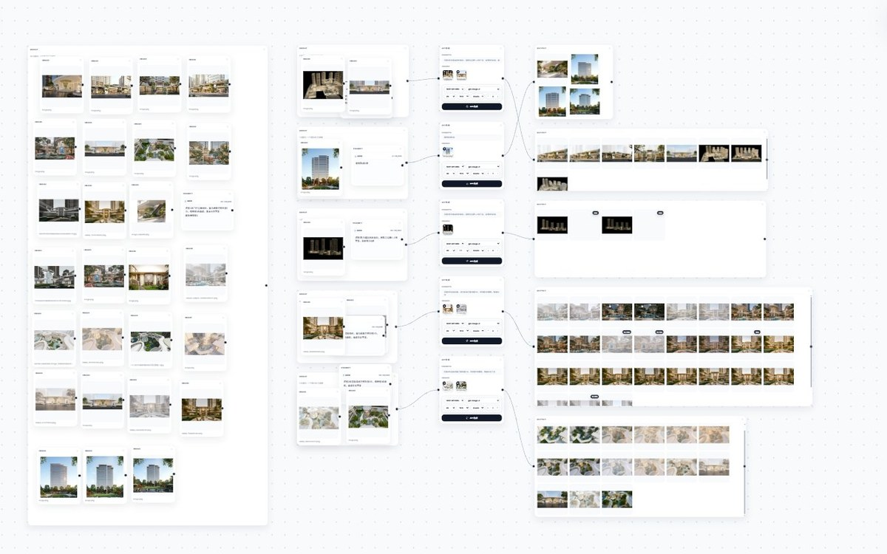
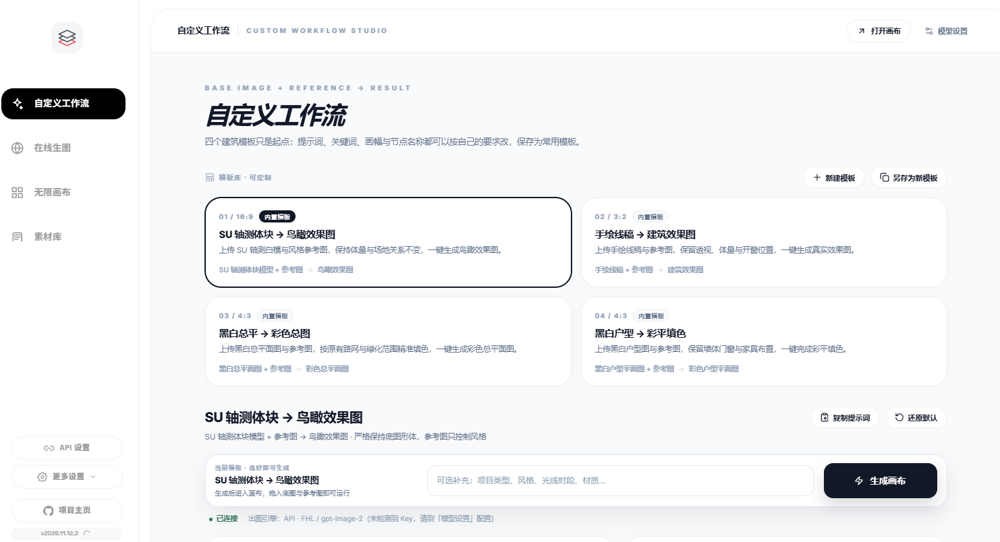
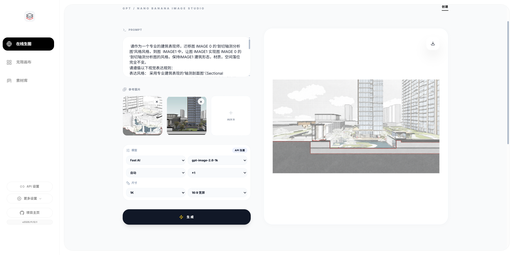
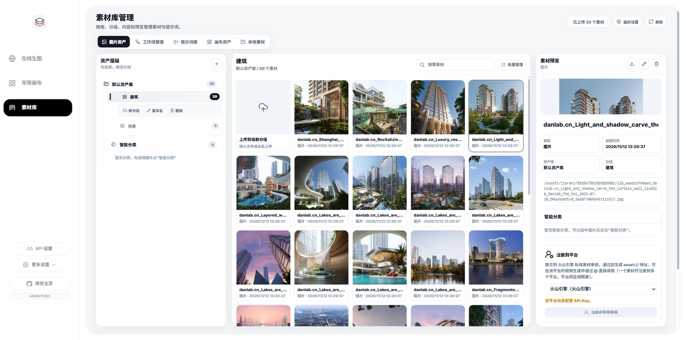

<div align="center">

<p>
  <a href="README.md">简体中文</a> ·
  <a href="README.en.md">English</a> ·
  <a href="README.fr.md">Français</a> ·
  <a href="README.es.md">Español</a> ·
  <b>Русский</b> ·
  <a href="README.ko.md">한국어</a> ·
  <a href="README.ja.md">日本語</a>
</p>

# Бесконечный холст

**Идеи, генерация и архив — на одном холсте.**

Локальная студия AI-творчества: пользовательские воркфлоу, онлайн-студия, бесконечный холст и библиотека материалов — четыре модуля, один поток.<br />
Без установки · Работает офлайн · Данные остаются на вашем компьютере

<br />

<a href="https://iorlchoate.github.io/infinite-canvas-site/"></a>&nbsp;&nbsp;
<a href="https://github.com/Iorlchoate/Infinite-Canvas-UDG/releases/latest"></a>&nbsp;&nbsp;
<a href="#быстрый-старт"></a>

</div>



## Быстрый старт

1. Откройте [Releases](https://github.com/Iorlchoate/Infinite-Canvas-UDG/releases/latest) и скачайте последний `Infinite-Canvas-UDG-<version>-win.zip`
2. Распакуйте в любую папку и дважды щёлкните **`start.bat`** — браузер откроется сам (`127.0.0.1:3000`; если порт занят, он сдвинется)
3. Откройте **API Settings**, вставьте ключ API, сохраните и начинайте создавать

> Портативная сборка включает Python и все офлайн-зависимости: **Python ставить не нужно, окружение настраивать не нужно, всё работает без интернета**.
> После распаковки сохраните папки `python/` и `packages/`.

## Доступ с телефона и планшета

Приложение устанавливать не нужно: подключите устройство к той же Wi-Fi и откройте LAN-адрес, который печатает консоль после `start.bat`:

```text
Same Wi-Fi (phone/tablet): http://192.168.x.x:3000/
```

| Устройство | Браузер | Рекомендуемые шаги |
| --- | --- | --- |
| Android-телефон | Chrome / Edge | Открыть адрес → меню «Добавить на главный экран» → полный экран |
| Android-планшет | Chrome / Edge | Открыть в горизонтальной ориентации; перетаскивать узлы одним пальцем, масштабировать двумя |
| iPhone | Safari | Открыть адрес → «Поделиться» → «На экран «Домой»» |
| iPad | Safari | Открыть в горизонтальной ориентации; «Поделиться» → «На экран «Домой»» |

**Сенсорное управление:** один палец — перетаскивание узлов / панорамирование, два пальца — масштабирование, двойной щелчок — редактирование. Страницы холста удобнее в горизонтальной ориентации.

**Если не открывается:** проверьте, что оба устройства в одной Wi-Fi (не гостевая сеть и не мобильный интернет), используйте адрес `192.168.x.x`, а не `127.0.0.1`; разрешите Python в брандмауэре Windows; отключите VPN и изоляцию AP на роутере.

> Данные, материалы и ключи API остаются на компьютере. Когда компьютер выключен или приложение закрыто, телефон и планшет не смогут подключиться. Удалённый доступ требует туннеля или проброса портов — на ваш риск. Нативных APK / IPA пока нет.

## Почему локально

| Без аккаунта | Без загрузки | Без настройки |
| --- | --- | --- |
| Нет регистрации и облачного рабочего пространства | Материалы, история и ключи остаются у вас | Распаковать, запустить, создавать |

Приложение обращается только к тому API, который вы настроили, и только когда вы сами вызываете облачную модель.

## Четыре модуля — один поток

| Модуль | В одной строке |
| --- | --- |
| **Пользовательские воркфлоу** | Четыре архитектурных шаблона с редактируемыми названием, форматом, узлами и промптами; замена слов, копирование и сброс |
| **Онлайн-студия** | От 1 до 9 референсов с номерами IMAGE — на них можно ссылаться прямо в промпте |
| **Бесконечный холст** | Свободные узлы и связи; текст→изображение, изображение→изображение, локальная правка, расширение и мультивидовые сетки |
| **Библиотека материалов** | Группы, пакетная сортировка, умные категории; расширение Chrome и коннектор Photoshop |

## Скриншоты

**Пользовательские воркфлоу**



**Онлайн-студия**



**Библиотека материалов**



## Последние обновления

- **Направляющие выравнивания**: привязка с порогом 7 px при перетаскивании / изменении размера, синие пунктирные линии, `Ctrl / ⌘` — временно отключить
- **Контейнеры групп**: шапка 52 px, автоподгонка, сетка по пропорциям, переименование двойным щелчком, плавающая панель (скачать / склеить в длинное изображение / разгруппировать)
- **Отсечение по области просмотра**: при 60+ узлах монтируются только ближайшие карточки; холст на 300 узлов при первом рендере монтирует 3 карточки и добавляет остальные при прокрутке

## Для кого

- Архитекторы и дизайнеры, которым нужен путь **референс → генерация → отбор → архив** на одном экране
- Те, кто использует API изображений, но не хочет отдавать материалы и ключи в облако
- Команды, которым нужна локальная библиотека с коннекторами Photoshop / Chrome

## Документация

| Что | Где |
| --- | --- |
| Сайт проекта | <https://iorlchoate.github.io/infinite-canvas-site/> |
| Скачивание и установка | [Releases](https://github.com/Iorlchoate/Infinite-Canvas-UDG/releases/latest) |
| Заметки о версиях | [update-notes.json](https://github.com/Iorlchoate/Infinite-Canvas-UDG/blob/main/update-notes.json) |
| Проблемы | [GitHub Issues](https://github.com/Iorlchoate/Infinite-Canvas-UDG/issues) |
| Исходный проект | [hero8152/Infinite-Canvas](https://github.com/hero8152/Infinite-Canvas) |

<details>
<summary><b>macOS / Linux и запуск из исходников</b></summary>

<br />

**macOS / Linux**

```bash
pip3 install -r requirements.txt
python3 main.py
```

Или запустите `mac-启动服务.sh`; на macOS при проблемах с правами сначала выполните `mac-修复权限.command`.

**Из исходников (Windows)**

```bash
git clone https://github.com/Iorlchoate/Infinite-Canvas-UDG.git
cd Infinite-Canvas-UDG
start.bat
```

</details>

<details>
<summary><b>Структура репозитория и публикация (для мейнтейнеров)</b></summary>

<br />

```text
main.py                 # Backend на FastAPI
static/                 # Страницы фронтенда (холст / материалы / настройки)
static/js/              # Скрипты фронтенда
data/                   # Рабочие данные (холсты, материалы, конфиг)
tools/                  # Расширения Chrome / Photoshop, скрипты публикации
packages/               # Офлайн-зависимости
python/                 # Портативный Python для Windows
start.bat               # Запуск в Windows (проверка зависимостей + порт)
```

Не публикуйте рабочую папку после запуска: в ней появляются `API/.env`, `history.json`, `assets/`, `data/`. Используйте скрипты упаковки:

```bash
python tools/make_release_zip.py
# dist/Infinite-Canvas-UDG-<version>-win.zip

python tools/make_release_dir.py
# dist/Infinite-Canvas-UDG-<version>-publish/
```

</details>

## FAQ

<details>
<summary><b>Это бесплатно? Можно использовать коммерчески?</b></summary>
Проект бесплатный и открытый, с указанием авторства. У исходного Infinite-Canvas есть регистрация авторских прав; его условия (производные должны оставаться открытыми, авторство сохраняется, закрытая коммерческая переупаковка запрещена) действуют для исходного кода.
</details>

<details>
<summary><b>Мои изображения и ключ API куда-то отправляются?</b></summary>
Нет. Материалы, история и ключи остаются на вашем компьютере. Приложение обращается только к настроенному API, когда вы вызываете облачную модель.
</details>

<details>
<summary><b>Порт занят или не хватает зависимостей?</b></summary>
Порт сдвигается на 3001, 3002 и т. д.; задайте <code>CANVAS_PORT</code>, чтобы зафиксировать его. Если зависимостей нет, <code>start.bat</code> восстановит их офлайн из <code>packages/</code>.
</details>

## Открытый код и благодарности

Проект основан на открытом [Infinite-Canvas](https://github.com/hero8152/Infinite-Canvas) автора **wuli大雄**, с указанием авторства и на тех же открытых условиях.

Исходный проект не обновляется с 28.08.2026 и не связан с этим проектом.

- Автор: [Bilibili](https://space.bilibili.com/78652351) · Новый проект: [DX-OS](http://www.DX-OS.com)
- Видеоурок: [YouTube](https://youtu.be/1y9ShTvgC_w)
- Расширение Chrome: [Установить](https://chromewebstore.google.com/detail/infinite-canvas-%E5%9B%BE%E5%83%8F%E8%A7%86%E9%A2%91%E6%96%87%E5%AD%97%E6%8A%93%E5%8F%96%E5%B7%A5/ajfhnbklbmpfaaookhfakohabnpmlcic)

<div align="center">

**Откройте холст. Начните создавать.**

[Сайт](https://iorlchoate.github.io/infinite-canvas-site/) · [Скачать](https://github.com/Iorlchoate/Infinite-Canvas-UDG/releases/latest) · [Issues](https://github.com/Iorlchoate/Infinite-Canvas-UDG/issues)

</div>
